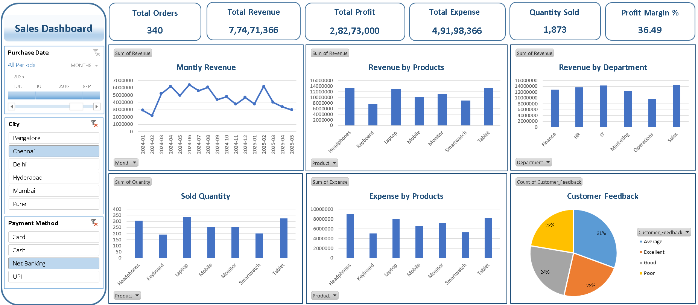

# Sales-Performance-Analysis
Sales performance, profitability and customer analysis using Excel dashboard and data analytics.

## 📌 Project Overview

This project analyzes sales transaction data to evaluate sales
performance, profitability, product performance, customer
satisfaction, and payment trends.

An interactive Excel dashboard was developed to transform
transaction-level data into meaningful business insights and
support data-driven decision making.

---

## 🎯 Objectives

- Analyze sales performance across products, departments,
  cities, and time periods.
- Evaluate revenue, expenses, profit, and profit margin.
- Understand customer behavior and satisfaction.
- Build an interactive Excel dashboard for business reporting.

---

## 📊 Dataset

The dataset contains 8,000 sales transactions with information
related to:

- Customer
- Product
- Department
- City
- Quantity
- Revenue
- Expense
- Profit
- Customer Rating
- Customer Feedback
- Payment Method
- Purchase Date

---

## 🛠️ Tools & Technologies

- Microsoft Excel
- Power Query
- PivotTables
- Excel Charts
- Data Analysis
- Exploratory Data Analysis
- Data Visualization

---

## 🔄 Project Workflow

Raw Data
→ Data Cleaning
→ Exploratory Analysis
→ KPI Calculation
→ Dashboard Development
→ Business Insights
→ Recommendations

---

## 📈 Key KPIs

| KPI | Value |
|---|---:|
| Total Transactions | 8,000 |
| Total Revenue | ₹176.46 Cr |
| Total Profit | ₹61.58 Cr |
| Profit Margin | 34.90% |
| Quantity Sold | 43,919 |
| Total Expenses | ₹114.88 Cr |

---

## 🔍 Key Insights

### Sales & Profitability
- Revenue remained relatively stable throughout 2024 and early
  2025 before a significant decline in May 2025.
- Laptops and Headphones are major revenue contributors.
- Tablets demonstrate strong sales volume with relatively
  controlled expenses.
- Mobile products show comparatively weaker performance.

### Customer & Department
- IT is the strongest revenue-generating department.
- HR and Marketing contribute comparatively lower revenue.
- Poor and Average ratings together account for 51% of customer
  responses, highlighting a customer experience opportunity.

---

## 💡 Recommendations

1. Optimize the product portfolio by focusing on high-performing
   and profitable products.
2. Improve customer experience by analyzing negative feedback.
3. Strengthen marketing efforts around high-performing products
   and cross-selling opportunities.
4. Monitor revenue and profitability trends regularly to identify
   operational issues early.

---

## 📊 Dashboard

---

## 📂 Project Files

- `Dataset/` – Source sales dataset
- `Excel_Dashboard/` – Interactive Excel dashboard
- `Presentation/` – Project presentation
- `Screenshots/` – Dashboard preview
